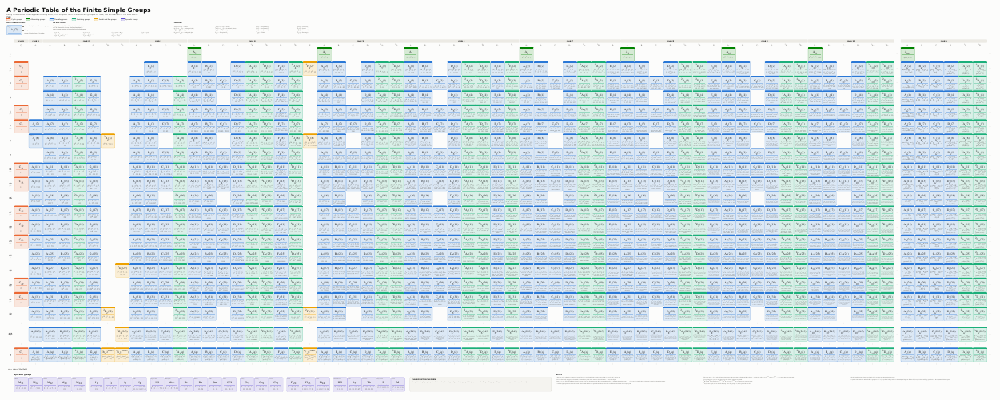

# A Periodic Table of the Finite Simple Groups

A parametrised generator for a one-page poster that lays out **every finite
simple group exactly once**, in the style of a periodic table.



The PDF is vector-only and is produced directly by Python (reportlab) — no
LaTeX or other external toolchain is needed.

## Reading the table

**Each cell** has three lines:

* the top line, flush left, lists **other descriptions of the same group** —
  only one-off coincidences, such as `A_1(7) ≅ A_2(2)`.  A second notation for
  the same construction (`A_n(q) = L_{n+1}(q)`) is in the key of families
  instead, and a rule about whole families (`B_n(q) ≅ C_n(q)` for even `q`) is
  stated once in the key of empty cells rather than on each of the thirty-odd
  cells it applies to;
* the middle line is **the group**;  the three bands have fixed heights, so
  symbols and rules line up right across a row, and each band is given room
  beyond its measured height — a symbol's subscripts reach below the line box
  reportlab reports and the order's superscripts reach above theirs, so
  without that margin the two would touch;
* the bottom line is the **prime factorisation of its order**.  A cell that
  carries a parameter shows the generic order formula instead, and so does a
  cell whose factorisation is too long to print (with the defaults, only
  `E_8(243)`).  Each of the three lines is set as large as its own box
  allows, so the order line grows up to its cap wherever the factorisation is
  short.

**A symbol with a subscript and no field is a group over "the field with one
element":** `C_p` is cyclic of order `p` and `A_m` is alternating of degree
`m`.  With a field, `A_n(q)` is linear and `C_n(q)` symplectic — the argument
is what tells the two apart.

**The vertical axis is the field size `q`.**  The `q = 1` row comes first,
then one row per prime power up to `--q-max`, then the rows of `--extra-q`,
then a generic `q` row.  Wherever prime powers are skipped the axis carries an
ellipsis.

* **`q = 1` is the alternating groups.**  Over "the field with one element" a
  group of Lie type degenerates to its Weyl group, so the cell `A_n(1)` holds
  `A_{n+1}`.  Only type A is simple there, which is why the rest of that row
  is empty.  `A_n(1)` is an address, not a name: the group is printed as
  `A_{n+1}`.
* **The `--extra-q` rows** (243 by default) are there because the Suzuki and
  Ree families exist only for `q = 2^(2m+1)` and `q = 3^(2m+1)`; without
  `q = 243` the `²G_2` column would carry a single group.

**The first column** is the cyclic groups `C_p` — a cell exists only on the
rows whose `q` is prime.

**After it the columns are grouped by rank.**  Every family with a simple
group of rank 1, then of rank 2, and so on:

```
A_1 | A_2 B_2 ²A_2 G_2 ²B_2 ²G_2 | A_3 B_3 C_3 ²A_3 | A_4 B_4 C_4 D_4 ²A_4 ²D_4 F_4 ³D_4 ²F_4 | …
```

Inside a block the order is `A, B, C, D, ²A, ²D`, then the exceptional
families of that rank.  A family starts at the rank below which it would
duplicate another one (`B_1 = A_1`, `C_2 = B_2`, `D_3 = A_3`, `²D_3 = ²A_3`),
which is why rank 2 has no `C_2` and rank 3 no `D_3`.  `E_8` is the last
family that ever appears, so past rank 8 every block is the same six classical
families; the blocks run to `--rank-max` and are then replaced by an ellipsis,
the generic-rank block `A_n B_n C_n D_n ²A_n ²D_n`, and a second ellipsis.

**The sporadic groups** get a strip of their own at the bottom, with a small
gap between series, so the Mathieu, Janko, Conway and Fischer runs stand
apart.

**Background colour encodes the type** of group: cyclic, alternating,
**Chevalley** (the untwisted groups of Lie type), **Steinberg** (`²A_n`, `²D_n`,
`³D_4`, `²E_6`), **Suzuki and Ree** (`²B_2`, `²G_2`, `²F_4`), and sporadic.
The generic cell of a Suzuki or Ree family is written in powers of 2 or of 3
rather than in `q`, since `q` is not free there.

**No repetitions.**  Every group is printed under its simplest description
only.  Where a group would appear twice the cell is simply **left empty**, and
the masthead carries a key saying where each missing group is
(`A_1(4), A_1(5) → A_5`, `C_n(q), q even → B_n(q)`, …).  An empty cell with no
entry in that key means the group is not defined there, or is not simple.

## Use

```bash
python3 make_poster.py --out out/finite_simple_groups.pdf
python3 make_poster.py --help          # every parameter
python3 selftest.py                    # check the mathematical content
```

The parameters the task left open are command-line options; the defaults are
the ones used for `out/finite_simple_groups.pdf`:

| option | default | meaning |
|---|---|---|
| `--rank-max` | 10 | largest rank with its own block of columns, before the ellipsis |
| `--q-max` | 32 | largest field size in the contiguous block of rows |
| `--extra-q` | 243 | further q rows, so that no column carries a single group |
| `--no-f1-row` | off | drop the `q = 1` row, and with it the alternating groups |
| `--sporadic-cols` | 26 | columns of the sporadic block (26 = a single strip) |
| `--cell-w`, `--cell-h` | 100, 100 | cell size in points |
| `--dots-frac` | 0.42 | size of an ellipsis row/column, relative to a cell |
| `--symbol-size`, `--order-size` | 20, 14 | font size caps;  each line is set as large as its box allows |
| `--max-order-lines` | 7 | lines the order line may wrap onto |
| `--no-alt-names` | off | drop the top line of every cell |
| `--title`, `--subtitle` | | the masthead text |

The page size is computed from the grid, so changing `--rank-max` or
`--q-max` simply makes a larger or smaller poster.  The defaults give
**244 × 98 cm**.

## How it is put together

| file | contents |
|---|---|
| `fsg/arith.py` | primality, Pollard-rho factorisation, and the cyclotomic splitting `q^k − 1 = ∏_{e\|k} Φ_e(q)` that makes the big orders factor instantly |
| `fsg/groups.py` | the families, their order formulas, the rank blocks, the coincidences, the 26 sporadic groups; produces one `Cell` per box |
| `fsg/render.py` | the grid model and all drawing |
| `make_poster.py` | command-line front end |
| `selftest.py` | orders checked against published values, and a check that no group is printed twice |

### On the orders

Orders of groups of Lie type are products of `q^N` with factors `q^k ± 1`.
Factoring those directly is hopeless for, say, `E_8(243)`, but each
`q^k − 1` splits into cyclotomic values `Φ_e(q)`, each of size about `q^φ(e)`,
and those factor in microseconds.  `q^k + 1` is handled as
`(q^{2k} − 1)/(q^k − 1)`.  A factorisation is printed with a space after each
`·`, which is the only place a line may break, so a prime power is never split
across two lines.

### On the "no repetitions" rule

`selftest.py` collects every group the poster prints and groups them by order.
The only collisions it tolerates are the two genuine ones — `A_8` and
`A_2(4) = L_3(4)` (both of order 20160, non-isomorphic), and `B_n(q)` /
`C_n(q)` for odd `q` and `n ≥ 3`.  Anything else would mean a missed
isomorphism.

### On the colours

The six category hues come from a colour-vision-validated categorical palette,
chosen so that every pair of categories that ends up side by side on the
poster clears the CVD separation gate — including `Steinberg` next to
`Suzuki and Ree`, which meet at `³D_4 | ²F_4` in the rank-4 block.  Cells use a 15 %
tint of the hue with a saturated accent bar, so that the text on them keeps
full contrast; identity is never carried by colour alone — every cell is
labelled and the legend is always present.
